# 🎨Canvas

<p align="center">
    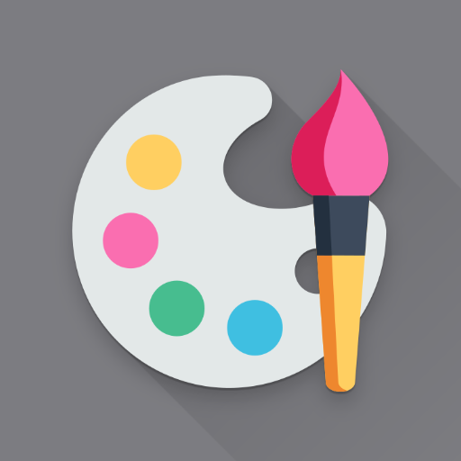
</p>

### Paint & Draw

**Sketch, Doodle & Create Art Easily!**

The simplest way to express your creativity – just tap, draw, and create!

Unleash your inner artist with **Paint & Draw**, the ultimate lightweight and user-friendly drawing app for everyone — from beginners to pros. Whether you want to doodle for fun, sketch ideas, or create digital art masterpieces, this app gives you the tools to make it happen in seconds.

<p align="center">
    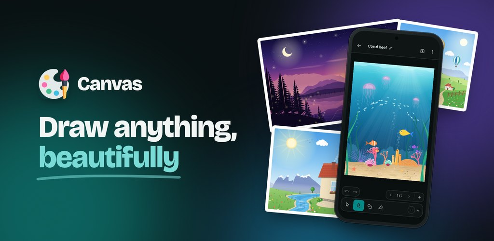
</p>

---

<details>
<summary><strong>📋Table of Contents</strong></summary>

- [📸 Screenshots](#-screenshots)
- [✨ Features](#features)
- [🛠 Tech Stack](#-tech-stack)
- [📁 Project Structure](#-project-structure)
- [Supported Platforms](#supported-platforms)
- [Releases](#releases)
  - [Android App](#android-app)
  - [iOS App](#ios-app)
  - [Desktop](#desktop)
- [Contribution](#contribution)
- [Licence](#licence)
- [Contributors](#contributors)

</details>

---

## 📸 Screenshots

### Phone

<p align="center">
    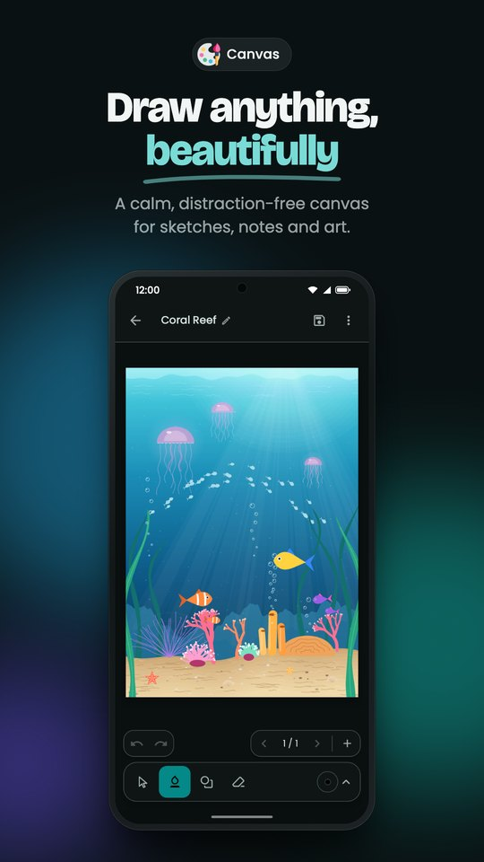
    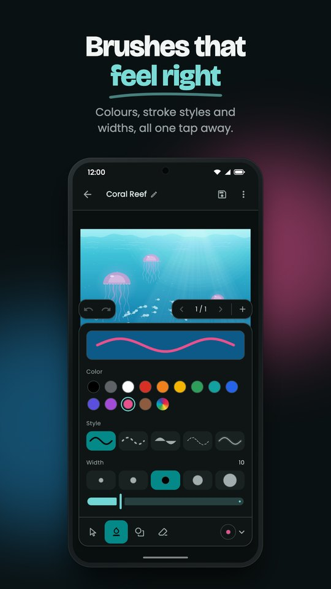
    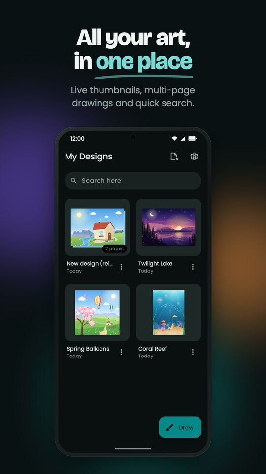
    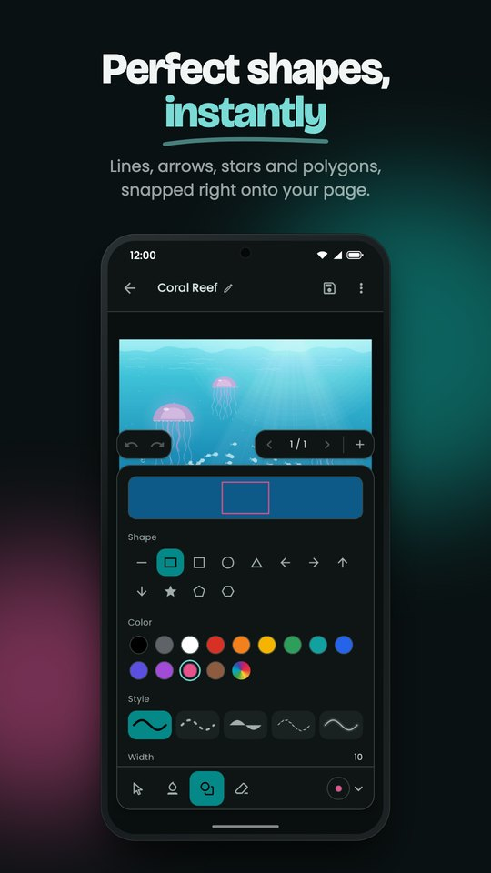
</p>
<p align="center">
    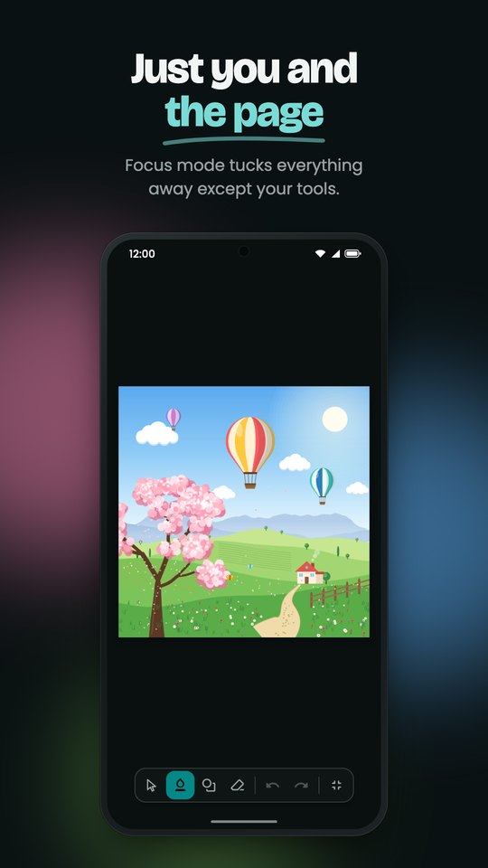
    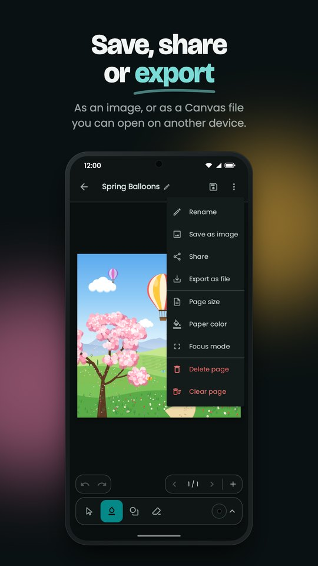
    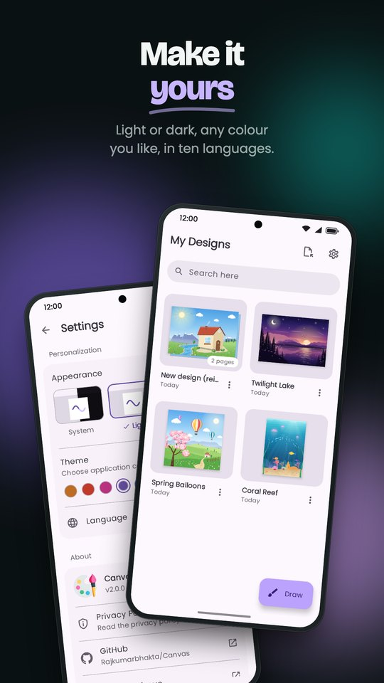
</p>

### Tablet

<p align="center">
    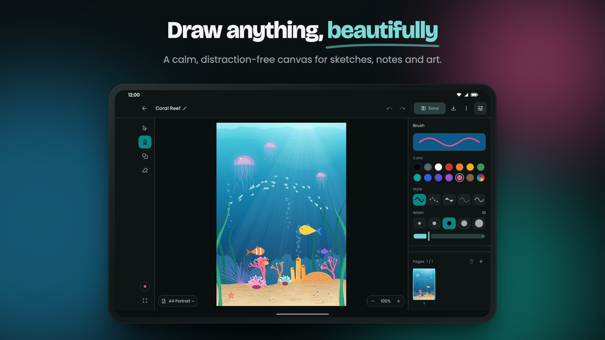
    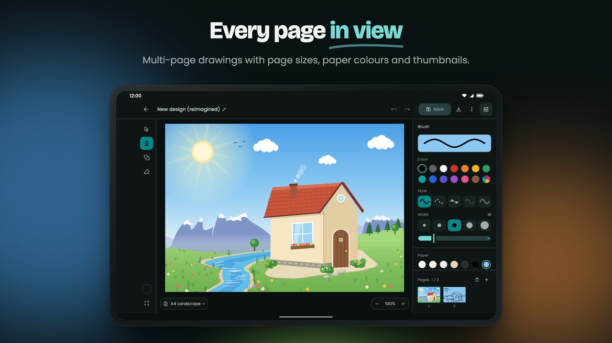
</p>
<p align="center">
    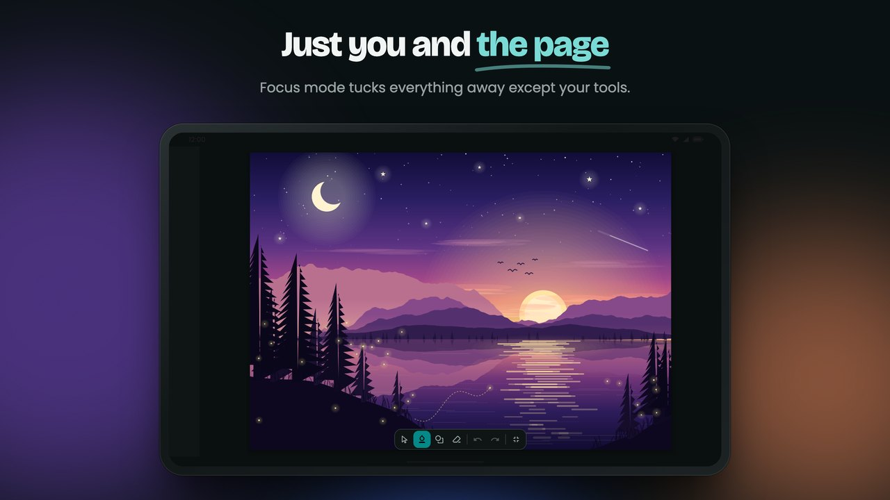
    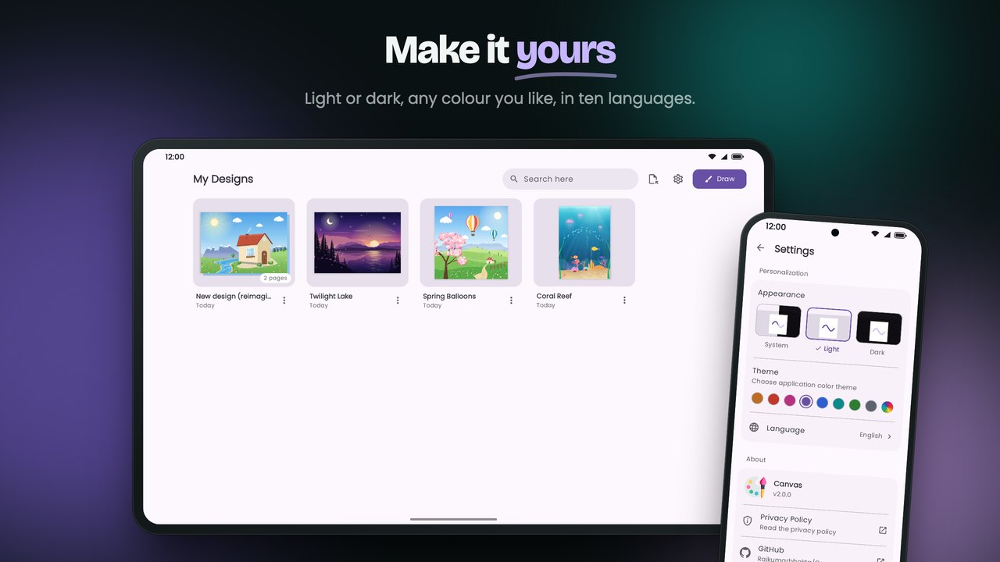
</p>

---

## ✨ Features

- **Simple & Clean Interface:** Start drawing instantly with a distraction-free design.
- **Customizable Brushes & Colors:** Select from various brush types, sizes, and a full-color palette.
- **Intuitive Canvas:** Draw, erase, and edit with precision on a responsive canvas.
- **Undo & Redo:** Effortlessly step backward or forward through your drawing actions.
- **Save & Share:** Export your creations as images and share them easily.
- **Dark Mode Support:** Draw comfortably in any lighting condition.
- **Offline Functionality:** Create art anytime, even without an internet connection.
- **Localization:** Translate the app to your preferred language.

## 🛠 Tech Stack

- **Kotlin** – Kotlin is a modern, statically typed, cross-platform programming language developed by JetBrains.
- **Compose Multiplatform** – Compose Multiplatform is a declarative framework for building beautiful shared UIs across Android, iOS, desktop, and web – powered by Kotlin Multiplatform.
- **Coroutines** – Asynchronous programming for smooth UI interactions
- **Data Store ( for KMP )** – Local storage for storing user preferences 
- **Room DB ( for KMP )** – Local database for storing user drawings 
- **Material Design** – UI/UX guidelines and components

## 📁 Project Structure

```bash
Canvas/            
├── composeApp/                    
│        ├── desktopAppIcons/
│        │     ├── LinuxIcon.png
│        │     ├── MacosIcon.icns
│        │     └── WindowsIcon.ico
│        ├── src/
│        │     ├── androidMain/
│        │     ├── commonMain/
│        │     ├── commonTest/kotlin/com/rkbapps/canvas/
│        │     ├── iosMain/kotlin/
│        │     ├── jvmMain/kotlin/
│        │     └── nativeMain/kotlin/com/rkbapps/canvas/
│        └── build.gradle.kts                    
├── gradle/
│       ├── wrapper/
│       │     ├── gradle-wrapper.jar
│       │     └── gradle-wrapper.properties
│       └── libs.versions.toml          
├── icons/
│     ├── android/
│     ├── ios/
│     ├── macos/
│     └── web/          
├── iosApp/ 
│     ├── iosApp.xcodeproj/
│     │     ├── project.xcworkspace/
│     │     └── project.pbxproj
│     └── iosApp/ 
│            ├── Assets.xcassets/
│            ├── Preview Content/Preview Assets.xcassets/
│            ├── Info.plist
│            └── iosApp.swift                              
├── .gitignore                      
├── CODE_OF_CONDUCT.md              
├── LICENSE                
├── README.MD                      
├── build.gradle.kts                                            
├── gradle.properties                             
├── gradlew
├── gradlew.bat               
└── settings.gradle.kts               
          

```


## Supported Platforms


<p align="center">
    
    
    
    
    
</p>

<p align="center">
    <b>Android</b> &nbsp; | &nbsp; <b>iOS</b> &nbsp; | &nbsp; <b>Desktop (Windows, Mac, Linux)</b> &nbsp; 
</p>

---


## Releases

### Android App

[](https://play.google.com/store/apps/details?id=com.rkbapps.canvas)

### iOS App

To run the application on an iPhone device or simulator:

- Open `iosApp/iosApp.xcproject` in Xcode and run the standard configuration.
- Or use the [Kotlin Multiplatform Mobile plugin](https://plugins.jetbrains.com/plugin/14936-kotlin-multiplatform-mobile) for Android Studio.

To run iOS simulator UI tests:
```sh
./gradlew :composeApp:iosSimulatorArm64Test
```

### Desktop

To run the desktop application:

- Start the app: `./gradlew :composeApp:run`
- Start with **hot reload**: `./gradlew :composeApp:runHot`
- Run desktop UI tests: `./gradlew :composeApp:jvmTest`

---

## Contribution

We welcome contributions from the community! If you'd like to help improve Canvas, please follow these steps:

1. **Fork the repository** and create your branch from `main`.
2. **Open an issue** to discuss your proposed changes or features.
3. **Make your changes** with clear, descriptive commit messages.
4. **Test your changes** to ensure stability across supported platforms.
5. **Submit a pull request** with a detailed description of your changes.

Please review our [Code of Conduct](CODE_OF_CONDUCT.md) before getting started.

Thank you for helping make Canvas better!

## Licence

Copyright (C) 2025-2026 Rajkumar Bhakta and contributors.

This project is licensed under the [GNU General Public License v3.0](LICENSE).  
You are free to use, study, modify, and share this software. If you distribute it or a modified version of it, you must release the complete source code under the same licence and keep the copyright and licence notices.

This program is distributed in the hope that it will be useful, but WITHOUT ANY WARRANTY; without even the implied warranty of MERCHANTABILITY or FITNESS FOR A PARTICULAR PURPOSE.

See the [LICENSE](LICENSE) file for full license text.

<details>
<summary><strong>Earlier versions (MIT License)</strong></summary>

Versions of Canvas before 2.0.0 were released under the MIT License. Those releases, and the code contributed under them, remain available under the MIT License:

```
Copyright (c) 2025 Rajkumar Bhakta

Permission is hereby granted, free of charge, to any person obtaining a copy
of this software and associated documentation files (the "Software"), to deal
in the Software without restriction, including without limitation the rights
to use, copy, modify, merge, publish, distribute, sublicense, and/or sell
copies of the Software, and to permit persons to whom the Software is
furnished to do so, subject to the following conditions:

The above copyright notice and this permission notice shall be included in all
copies or substantial portions of the Software.

THE SOFTWARE IS PROVIDED "AS IS", WITHOUT WARRANTY OF ANY KIND, EXPRESS OR
IMPLIED, INCLUDING BUT NOT LIMITED TO THE WARRANTIES OF MERCHANTABILITY,
FITNESS FOR A PARTICULAR PURPOSE AND NONINFRINGEMENT. IN NO EVENT SHALL THE
AUTHORS OR COPYRIGHT HOLDERS BE LIABLE FOR ANY CLAIM, DAMAGES OR OTHER
LIABILITY, WHETHER IN AN ACTION OF CONTRACT, TORT OR OTHERWISE, ARISING FROM,
OUT OF OR IN CONNECTION WITH THE SOFTWARE OR THE USE OR OTHER DEALINGS IN THE
SOFTWARE.
```

</details>

## Contributors

<a href="https://github.com/Rajkumarbhakta/Canvas/graphs/contributors">
  
</a>

---